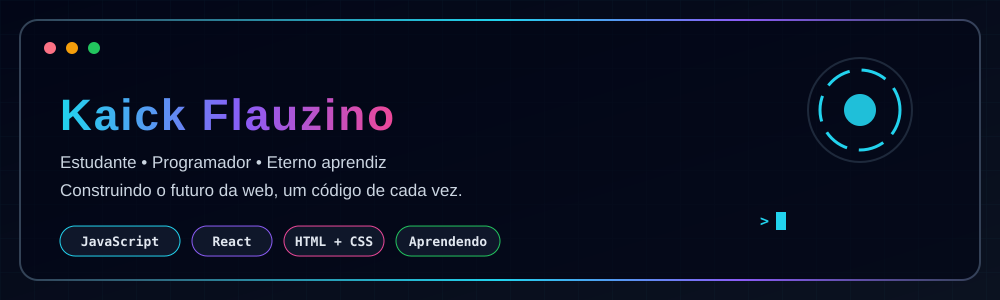
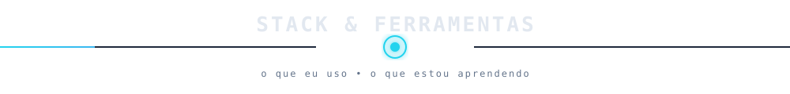
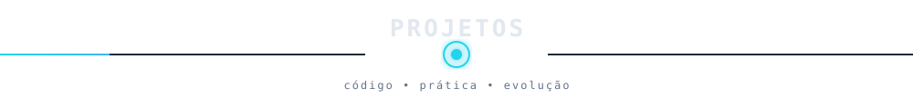
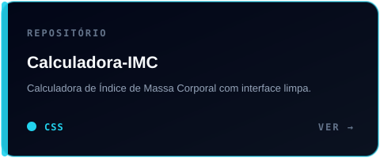
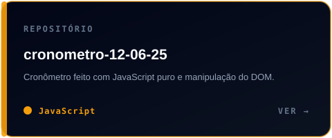
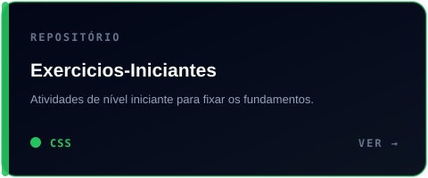
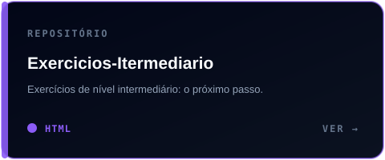
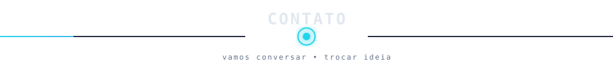

  

<h3 align="center">
  <samp>&gt; Olá! Eu sou o <b>Kaick</b> (@KaickFlauzin08)</samp>
</h3>

  <samp>「 Estudante, programador e eterno aprendiz. Construindo o futuro da web, um código de cada vez. 」</samp>

  

  
  
  

  <a href="#-sobre-mim"><b>Sobre</b></a>
  &nbsp;|&nbsp;
  <a href="#-stack--ferramentas"><b>Stack</b></a>
  &nbsp;|&nbsp;
  <a href="./docs/pages/PROJETOS.md"><b>Projetos</b></a>
  &nbsp;|&nbsp;
  <a href="#-contato"><b>Contato</b></a>

## 💻 Sobre mim

- 🎯 Apaixonado por **programação**, **tecnologia** e **desenvolvimento de software**
- 📚 Atualmente cursando o **Ensino Médio**
- 🧠 Sempre em busca de novos aprendizados e desafios
- 🌱 Praticando com exercícios e pequenos projetos para evoluir a cada semana

  

## 🛠 Stack & Ferramentas

<table align="center" cellspacing="0" cellpadding="10">
  <tr>
    <td align="center"> JavaScript</td>
    <td align="center"> HTML5</td>
    <td align="center"> CSS3</td>
    <td align="center"> React</td>
    <td align="center"> VS Code</td>
    <td align="center"> Figma</td>
    <td align="center"> Git</td>
    <td align="center"> GitHub</td>
  </tr>
</table>

  

## 🧪 Projetos em destaque

  
  

  
  

  <a href="./docs/pages/PROJETOS.md"><b>Ver página completa de projetos →</b></a>

### 📊 Estatísticas

  

  

  

  

## 📫 Contato

  
  

  ⚡ Estudando, errando, corrigindo e evoluindo, um commit de cada vez.

  Deixe uma estrela ⭐ nos repositórios se eles ajudaram você!

  

