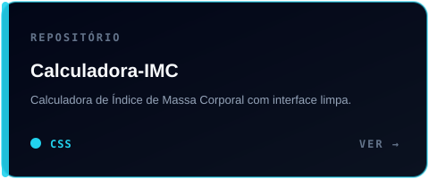
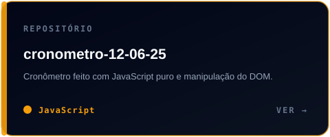
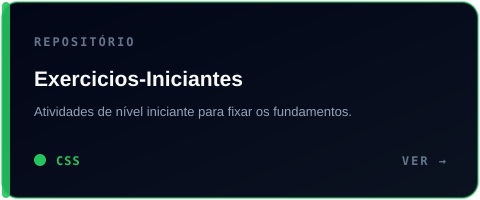
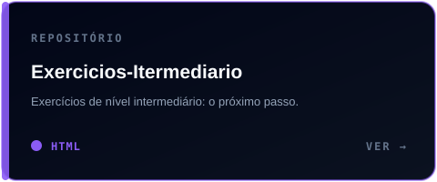

  

  <a href="../../README.md"><b>← Voltar ao início</b></a>

---

  <b>Projetos e exercícios que mostram minha evolução em desenvolvimento web.</b>

<h2 align="center">🧪 Destaques</h2>

  
  

  
  

---

## Como adicionar um novo projeto

1. Copie um arquivo de `docs/assets/svg/projects/` e troque nome, descrição, linguagem e cor.
2. Adicione o card aqui e no `README.md` apontando para o link do repositório.
3. Mantenha o `alt` descritivo em toda imagem.

  <a href="https://github.com/KaickFlauzin08?tab=repositories"><b>Ver todos os repositórios no GitHub →</b></a>

